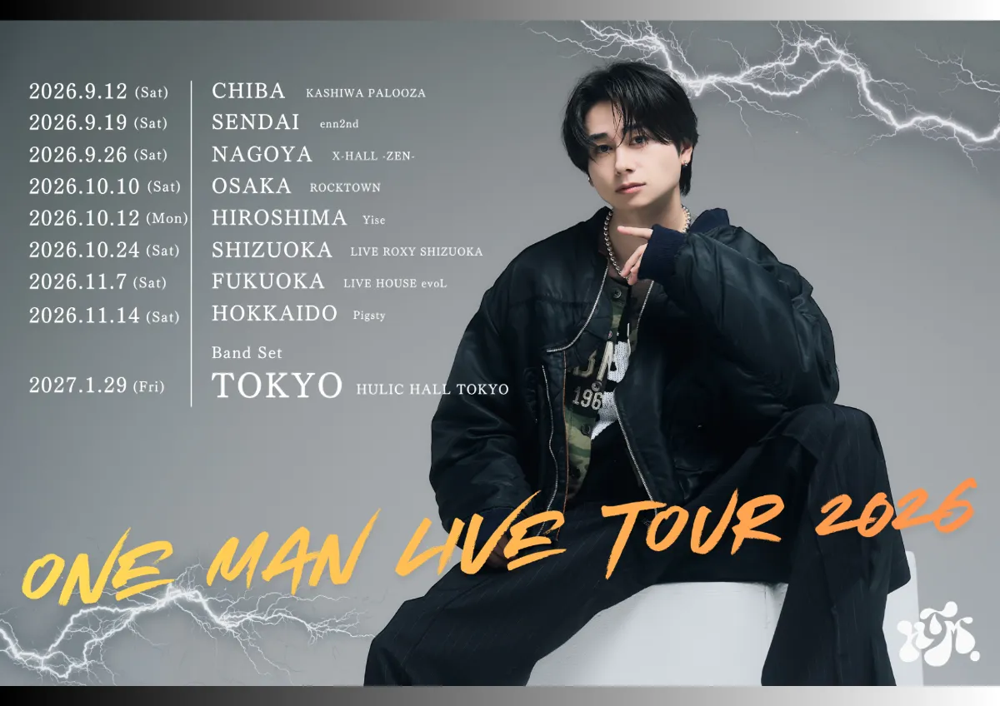

<!DOCTYPE html>
<html lang="ja">
<head>
  <meta charset="UTF-8" />
  <meta name="viewport" content="width=device-width, initial-scale=1.0" />
  <title>HASETOMO. ONE MAN LIVE TOUR 2026 ~ REVOLUTION ~</title>
  <meta name="description" content="HASETOMO. ONE MAN LIVE TOUR 2026 ~ REVOLUTION ~ チケットプレイガイド・公演日程まとめページ" />

  <!-- Google Fonts -->
  <link rel="preconnect" href="https://fonts.googleapis.com" />
  <link rel="preconnect" href="https://fonts.gstatic.com" crossorigin />
  <link href="https://fonts.googleapis.com/css2?family=Montserrat:ital,wght@0,600;0,800;0,900;1,800&family=Noto+Sans+JP:wght@400;500;700;900&family=Oswald:wght@500;700&display=swap" rel="stylesheet" />

  
</head>
<body>

  <!-- 背景稲妻アクセント -->
  

    <svg class="lightning-svg lightning-top" viewBox="0 0 200 200" fill="none">
      <path d="M120 10L65 95H110L85 190L155 85H105L120 10Z" stroke="currentColor" stroke-width="0.8" />
    </svg>
    <svg class="lightning-svg lightning-bottom" viewBox="0 0 200 200" fill="none">
      <path d="M90 15L40 105H85L65 185L135 85H90L90 15Z" stroke="currentColor" stroke-width="0.8" />
    </svg>
  

  <main class="container">

    <!-- ヒーローセクション：TOP画像 & タイトル -->
    <header class="hero-card">
      

        
        

      

      

        <h1 class="tour-title">
          HASETOMO.
          ONE MAN LIVE TOUR 2026
          ~ REVOLUTION ~
        </h1>
      

    </header>

    <!-- チケットプレイガイド リンクセクション -->
    <section class="section-block" aria-labelledby="ticket-heading">
      

        

          
          <h2 id="ticket-heading" class="section-title">
            TICKET チケット購入
          </h2>
        

        外部サイトへ移動します
      

      

        <!-- 1. イープラス -->
        <a
          href="https://eplus.jp/sf/detail/4369350001"
          target="_blank"
          rel="noopener noreferrer"
          class="ticket-card card-eplus"
        >
          

            
e+

            

              

                イープラス
                eplus
              

              
チケット申し込み・詳細はこちら

            

          

          

            <svg width="16" height="16" fill="none" stroke="currentColor" viewBox="0 0 24 24">
              <path stroke-linecap="round" stroke-linejoin="round" stroke-width="2.2" d="M7 17L17 7M17 7H8M17 7V16" />
            </svg>
          

        </a>

        <!-- 2. ローチケ -->
        <a
          href="https://l-tike.com/concert/mevent/?mid=797133"
          target="_blank"
          rel="noopener noreferrer"
          class="ticket-card card-ltike"
        >
          

            
L-tike

            

              

                ローチケ
                LAWSON TICKET
              

              
ローソンチケット 公演ページへ

            

          

          

            <svg width="16" height="16" fill="none" stroke="currentColor" viewBox="0 0 24 24">
              <path stroke-linecap="round" stroke-linejoin="round" stroke-width="2.2" d="M7 17L17 7M17 7H8M17 7V16" />
            </svg>
          

        </a>

        <!-- 3. チケットぴあ -->
        <a
          href="https://t.pia.jp/pia/event/event.do?eventBundleCd=b2671909"
          target="_blank"
          rel="noopener noreferrer"
          class="ticket-card card-pia"
        >
          

            
PIA

            

              

                チケットぴあ
                TICKET PIA
              

              
チケットぴあ 公演ページへ

            

          

          

            <svg width="16" height="16" fill="none" stroke="currentColor" viewBox="0 0 24 24">
              <path stroke-linecap="round" stroke-linejoin="round" stroke-width="2.2" d="M7 17L17 7M17 7H8M17 7V16" />
            </svg>
          

        </a>
      

    </section>

    <!-- ツアースケジュール一覧セクション -->
    <section class="section-block" aria-labelledby="schedule-heading">
      

        

          
          <h2 id="schedule-heading" class="section-title">
            SCHEDULE 公演日程
          </h2>
        

        ALL 9 SHOWS
      

      

        <!-- 1. CHIBA (公演終了) -->
        

          

            

              2026.9.12
              (Sat)
            

            公演終了
          

          

            CHIBA
            KASHIWA PALOOZA
          

        

        <!-- 2. SENDAI (公演終了) -->
        

          

            

              2026.9.19
              (Sat)
            

            公演終了
          

          

            SENDAI
            enn2nd
          

        

        <!-- 3. NAGOYA (公演終了) -->
        

          

            

              2026.9.26
              (Sat)
            

            公演終了
          

          

            NAGOYA
            X-HALL -ZEN-
          

        

        <!-- 4. OSAKA (公演終了) -->
        

          

            

              2026.10.10
              (Sat)
            

            公演終了
          

          

            OSAKA
            ROCKTOWN
          

        

        <!-- 5. HIROSHIMA (公演終了) -->
        

          

            

              2026.10.12
              (Mon)
            

            公演終了
          

          

            HIROSHIMA
            Yise
          

        

        <!-- 6. SHIZUOKA (公演終了) -->
        

          

            

              2026.10.24
              (Sat)
            

            公演終了
          

          

            SHIZUOKA
            LIVE ROXY SHIZUOKA
          

        

        <!-- 7. FUKUOKA (公演終了) -->
        

          

            

              2026.11.7
              (Sat)
            

            公演終了
          

          

            FUKUOKA
            LIVE HOUSE evoL
          

        

        <!-- 8. HOKKAIDO (公演終了) -->
        

          

            

              2026.11.14
              (Sat)
            

            公演終了
          

          

            HOKKAIDO
            Pigsty
          

        

        <!-- 9. TOKYO (Band Set) -->
        

          

            Band Set
            

              2027.1.29
              (Fri)
            

          

          

            TOKYO
            HULIC HALL TOKYO
          

        

      

    </section>

    <!-- URLコピー シェアボタン -->
    

      <button type="button" class="share-btn" onclick="copyPageUrl()">
        <svg width="16" height="16" fill="none" stroke="currentColor" viewBox="0 0 24 24">
          <path stroke-linecap="round" stroke-linejoin="round" stroke-width="2" d="M8 16H6a2 2 0 01-2-2V6a2 2 0 012-2h8a2 2 0 012 2v2m-6 12h8a2 2 0 002-2v-8a2 2 0 00-2-2h-8a2 2 0 00-2 2v8a2 2 0 002 2z" />
        </svg>
        このページのURLをコピーしてシェア
      </button>
    

    <!-- フッター -->
    <footer class="site-footer">
      
HASETOMO. ONE MAN LIVE TOUR 2026 ~ REVOLUTION ~

      
&copy; 2026 HASETOMO. All Rights Reserved.

    </footer>
  </main>

  <!-- コピー完了通知トースト -->
  

    

      <svg width="16" height="16" fill="none" stroke="currentColor" viewBox="0 0 24 24">
        <path stroke-linecap="round" stroke-linejoin="round" stroke-width="2.5" d="M5 13l4 4L19 7" />
      </svg>
      URLをクリップボードにコピーしました
    

  

  
</body>
</html>
